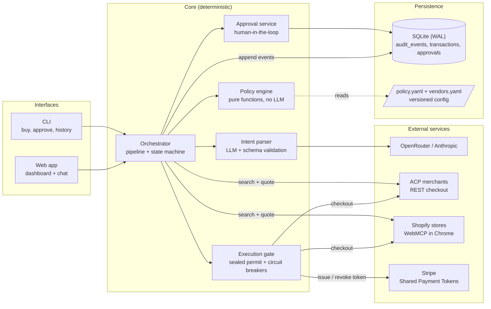
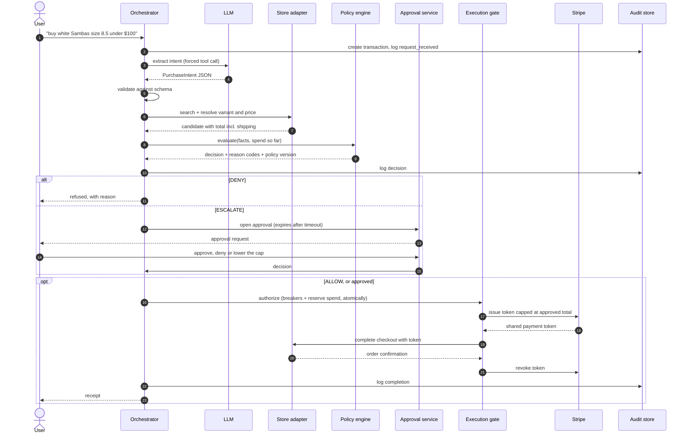
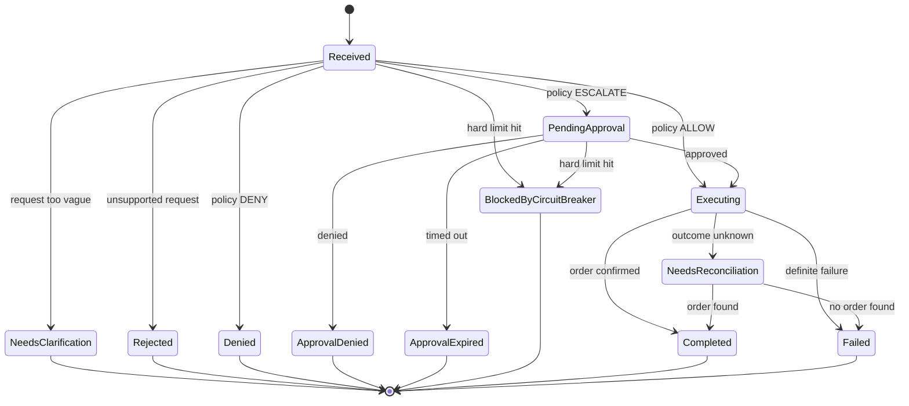
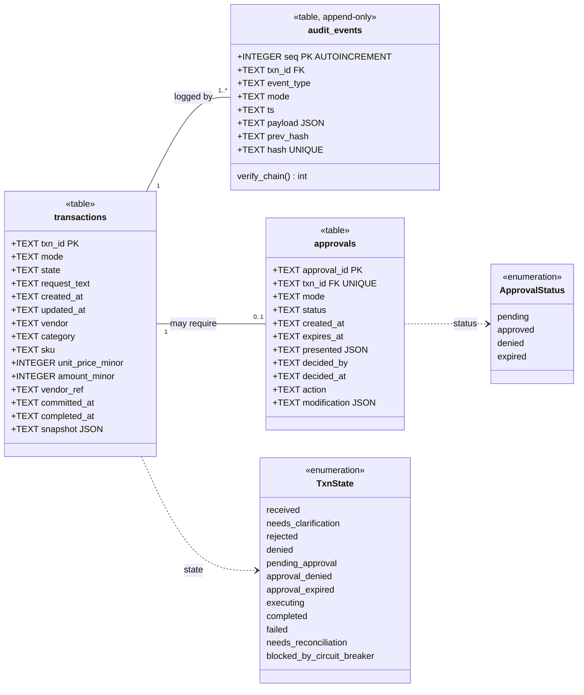

# Spenddat — Autonomous Purchasing Agent

Turns a plain-English request ("buy a phone case from acp merchant, under $25") into a real
purchase, governed by a deterministic, auditable policy engine. In-policy purchases execute
**autonomously**; only risky, ambiguous or out-of-policy ones are **escalated** to a human;
forbidden ones are **denied** outright. Every step lands in a tamper-evident audit log.

```
request ──► Intent parser (LLM, schema-validated) ──► Vendor adapter: search + resolve price
                                                          │
                              ┌── DENY ──► reject + notify user (no human, no purchase)
Policy engine (pure, no LLM) ─┼── ESCALATE ──► approval (human) ──► approve / deny / timeout
                              └── ALLOW ────────────┐                    │
                                                    ▼                    ▼
                               Execution gate ─► hard circuit breakers ─► scoped payment token
                                                 ─► vendor checkout ─► revoke token ─► audit
```

* **Vendor A:** any merchant implementing the **Agentic Commerce Protocol (ACP)** — an open
  REST checkout standard merchants publish *for* AI agents (official API, no scraping).
* **Payments:** **Stripe Shared Payment Tokens** — per-transaction, amount-capped,
  seller-scoped, time-limited, revoked after use. No card number ever touches this system.
* **Intent parsing:** Anthropic Messages API with a forced tool call, then deterministic
  validation.
* **Storage:** SQLite, hash-chained append-only audit log.

See [`docs/architecture.md`](docs/architecture.md) and the ADRs in [`docs/adr/`](docs/adr/).

## How I designed it

I wanted an agent that can actually spend money without me worrying about it. My rule
for the whole project: **the LLM never decides whether money moves.** The model only
turns my sentence into structured data. A deterministic policy engine makes the
decision, and a single execution gate is the only code path that can pay.

### User stories

I wrote these before the code and used the acceptance criteria as test cases.

| ID | As a… | I want to… | So that… | Acceptance criteria |
|---|---|---|---|---|
| US-1 | shopper | ask for a purchase in plain English ("white Sambas, size 8.5, under $100") | I don't have to browse stores myself | The request is parsed into item, size, colour, budget and store. Vague requests get a clarifying question instead of a guess. |
| US-2 | shopper | have small, in-policy purchases go through on their own | routine buying doesn't need me | An ALLOW decision executes with no human step, and the payment token is capped at the quoted total. |
| US-3 | shopper | approve risky or unusual purchases before they happen | I stay in control of anything out of the ordinary | An ESCALATE decision creates an approval showing item, store and full price. I can approve, deny or lower the cap. It expires after a timeout. |
| US-4 | shopper | have forbidden purchases refused outright | the agent can't be talked into buying something I've ruled out | Blocked stores and categories are DENIED before checkout, with a reason code. |
| US-5 | shopper | set budgets per purchase, per day, per week and per category | spending stays predictable | Policy lives in versioned YAML. Running totals are checked at the same moment the spend is reserved. |
| US-6 | shopper | shop across several stores, not just one | I get the best match and price | Every enabled store is searched; size/colour variants are matched and the cheapest valid option wins. |
| US-7 | owner | see every transaction and why it was decided that way | I can audit the agent | The dashboard shows history and spend. Each decision stores the policy version and the rules that fired. |
| US-8 | owner | know if anyone tampered with the log | the audit trail is trustworthy | Events are hash-chained and append-only. `spenddat verify-audit` detects any edited or deleted row. |
| US-9 | owner | never be charged twice, even after a crash | a timeout doesn't turn into a duplicate order | Idempotency keys on every request. Unknown outcomes go to reconciliation, never to a retry. |
| US-10 | developer | test everything without real money | I can iterate safely | Sandbox and live use separate secrets. Live needs an explicit confirmation latch. Shopify runs as a dry run in sandbox. |

### Architecture

The system has three layers. The **interfaces** take requests. The **core** decides.
The **adapters** talk to the outside world. Every adapter implements the same four-method
interface, so adding a store type never touches the policy or the orchestrator.



### Purchase sequence (technical view)

A single purchase from request to receipt. The `alt` block shows the three policy
outcomes. The payment token exists only for the few seconds of checkout and is revoked
straight after. Shopify stores skip the Stripe steps and use your saved Shop Pay card; the gate re-checks the total against the approved cap first.



### Transaction lifecycle (UML state machine)

Every transaction moves through these states and nothing else. Each transition writes
an audit event, so the state machine and the log always agree.



### Database (UML class diagram)

Three tables. `audit_events` is the source of truth. `transactions` and `approvals` are
read models I keep for fast queries. `audit_events` can't be changed after the fact:
SQLite triggers abort any `UPDATE` or `DELETE`, and each row stores the SHA-256 of the
previous row, so any edit breaks the chain. Money is always stored in integer cents,
never floats.



The indexes are `ix_events_txn(txn_id)` for per-transaction history and
`ix_txn_mode_state(mode, state)` for spend totals and the approval queue. Because every
row carries a `mode`, sandbox and live data can never be mixed up in a budget
calculation.

### How it feels to use (user view)

From the user's side it's a chat. Most purchases finish without any extra steps; the
agent only stops to ask when it should.


### Engineering decisions I'd highlight

- **Deterministic policy engine with an LLM only at the edge.** A dozen pure rules (budgets,
  category caps, price anomaly vs. past prices, velocity, blocklists, data quality)
  return ALLOW / ESCALATE / DENY with reason codes. The same inputs always give the same
  decision, which makes the engine easy to unit-test.
- **One way to pay.** Payment code only accepts an `ExecutionPermit`, and only the gate
  can mint one. The gate checks the hard circuit breakers (per-purchase, daily and weekly
  ceilings) in the same database transaction that reserves the spend, so two concurrent
  purchases can't both slip under a limit.
- **Least-privilege payments.** Stripe Shared Payment Tokens are capped at the approved
  amount, scoped to one seller, short-lived and revoked after use. My system never sees
  a card number.
- **Exactly-once purchasing.** Idempotency keys, and an "outcome unknown" state that
  triggers reconciliation instead of a retry.
- **Pluggable stores.** ACP merchants over REST, and Shopify stores through WebMCP tools
  in a real Chrome window.
- **Tested.** 229 automated tests, including a simulated Shopify store and an opt-in
  Stripe test-mode run.

---

## Quick start (sandbox, no credentials)

```bash
python -m venv .venv && . .venv/bin/activate
pip install -e ".[dev]"

make test          # full suite, sandbox only, no credentials, no network
make lint          # ruff lint + format check
make demo          # both PRD flows end-to-end over HTTP against a local ACP merchant
```

`make demo` starts the bundled reference ACP merchant, runs an in-policy request (ALLOW →
autonomous purchase) and an over-cap request (ESCALATE → approval → purchase), and prints
both audit trails.

## Web UI (dashboard + chat)

```bash
spenddat ui --demo        # sandbox demo, no credentials: opens http://127.0.0.1:8420
spenddat ui               # your configured sandbox/live setup (same checks as the CLI)
```

Two views, switched with the control at the top:

* **Dashboard** — spend today/this week against budgets, share of purchases handled
  autonomously, a 14-day spend chart (autonomous vs approved by you), the decision mix,
  searchable transaction history with a full audit-trail drawer per transaction, pending
  approvals with Approve / Approve up to $X / Deny, and every guardrail with live usage.
* **Chat** — talk to the agent: "buy a clear phone case for my iPhone 15 under $25",
  "how much have I spent?", "what's pending?", "show recent orders", "what are my limits?".
  Receipts, approval requests and denials appear as cards you can act on in place.

A third view, **Stores**, manages where the agent shops: add a store, turn it on or
off, and set its trust level — **Auto-buy** (in-policy purchases complete on their own),
**Ask me** (every purchase needs your approval) or **Blocked**. Trust levels are written
into your policy's `vendors.allow` / `vendors.deny` lists (comments preserved), the change
is recorded in the audit log, and the app reloads; if the new setup doesn't load, the
change is rolled back. When a request doesn't name a store, the agent searches every
enabled, non-blocked store and picks the best match, preferring Auto-buy stores, then the
lowest price. Sizes and colours are understood ("size 8.5 in white"); if a product comes
in several sizes or colours and you didn't say, it asks, and if yours is sold out it says
which sizes/colours are available.

The demo runs everything in-process: the bundled reference ACP store, a second "stub"
store, sandbox-only fake payments, and a week of sample history (`--reset` starts over,
`--no-seed` starts empty; demo files live in `data/demo/`, including a *copy* of your
policy, so demo trust changes never touch your real policy). Without a model key it
understands requests with a small offline keyword parser; add an OpenRouter key (below)
to use Claude.

### Model provider (OpenRouter or Anthropic)

Requests are turned into structured intents by Claude via either provider:

| Provider | Secret | Default model |
|---|---|---|
| OpenRouter | `openrouter_api_key` | `anthropic/claude-sonnet-5.5` |
| Anthropic | `anthropic_api_key` | `claude-sonnet-5-5` |

`SPENDDAT_LLM_PROVIDER=auto` (default) uses OpenRouter when its key is present, otherwise
Anthropic. Override the model with `SPENDDAT_LLM_MODEL` (for OpenRouter, a cheaper choice
is `anthropic/claude-haiku-4.5`). Quick start on Windows:

```cmd
copy .env.example .env
notepad .env        &:: add: SPENDDAT_SANDBOX_OPENROUTER_API_KEY=sk-or-...
spenddat ui --demo
```

The chat header shows which model is in use. The model only sees the request text and
the store/category names — never addresses, payment data or keys. It makes one call per
purchase request; questions like "how much have I spent?" don't call it.

The UI uses the same orchestrator as the CLI, so every policy, approval, ceiling and audit
guarantee is unchanged. The server binds to 127.0.0.1 only, rejects foreign `Host`
headers, and requires a same-origin custom header on every state-changing request.

## Configuration

| What | Where | Notes |
|---|---|---|
| Runtime mode | `SPENDDAT_MODE=sandbox\|live` | default `sandbox` |
| Live-mode safety latch | `SPENDDAT_LIVE_CONFIRM=I_ACCEPT_REAL_PURCHASES` | required for live |
| Policy | `policies/default.yaml` (`SPENDDAT_POLICY_FILE`) | versioned YAML, see below |
| Vendors | `config/vendors.yaml` (`SPENDDAT_VENDORS_FILE`) | per-mode endpoints; no secrets |
| Buyer profile | `config/profile.yaml` (`SPENDDAT_PROFILE_FILE`) | git-ignored; copy the example |
| Hard ceilings | `SPENDDAT_HARD_MAX_{TRANSACTION,DAILY,WEEKLY}_MINOR` | circuit breakers, cents |
| Secrets backend | `SPENDDAT_SECRETS_BACKEND=env\|command` | see *Secrets*; a `.env` file is also loaded |
| Payment backend | `SPENDDAT_PAYMENT_BACKEND=stripe\|fake` | `fake` refused in live |
| Model provider | `SPENDDAT_LLM_PROVIDER`, `SPENDDAT_LLM_MODEL` | see *Model provider* |

All variables are listed in [`.env.example`](.env.example).

### Sandbox vs live

One codebase, one code path. Mode selects **only** which credentials and endpoints are
loaded; the policy engine takes no mode input (a test asserts this) and decisions are
identical in both modes (a parametrised test asserts this too).

| | sandbox | live |
|---|---|---|
| Stripe key | `sk_test_…` / `rk_test_…` required | `sk_live_…` / `rk_live_…` required |
| Stripe `livemode` on each token | must be `false` | must be `true` |
| Vendor endpoints | `vendors.yaml → sandbox:` | `vendors.yaml → live:` (https only, no placeholders) |
| Secrets | `SPENDDAT_SANDBOX_*` | `SPENDDAT_LIVE_*` (never falls back to sandbox) |
| Fake payment/stub vendor | allowed | refused at construction |
| Startup | checks | strict checks + `SPENDDAT_LIVE_CONFIRM` latch; exits 78 on any problem |

The mode is written on every audit event and log line, and `history`/`approvals`/`spend`
accept `--mode sandbox|live|all`.

Validate a configuration without doing anything: `SPENDDAT_MODE=live spenddat check`.

### Secrets

Secrets are never in files. Names are namespaced by mode:

* **env backend** (CI/dev): `SPENDDAT_<MODE>_<NAME>`, e.g. `SPENDDAT_LIVE_STRIPE_SECRET_KEY`.
* **command backend** (production): any secrets-manager CLI, e.g.
  `SPENDDAT_SECRETS_COMMAND='op read op://spenddat/{mode}_{name}/credential'` or
  `aws secretsmanager get-secret-value --secret-id spenddat/{mode}/{name} --query SecretString --output text`.

| Secret name | Purpose |
|---|---|
| `stripe_secret_key` | Stripe key; a **restricted** key with Shared Payment Tokens write is recommended |
| `stripe_payment_method_id` | the buyer's saved PaymentMethod (`pm_…`) — a reference, not card data |
| `openrouter_api_key` | intent parsing via OpenRouter (either this or the next) |
| `anthropic_api_key` | intent parsing via Anthropic |
| `acp_merchant_api_key` | bearer key issued by the merchant (name set in `vendors.yaml`) |
| `approval_webhook_url` | optional Slack/Teams-style webhook for approval notifications |

Logs pass through a redaction filter (keys, bearer tokens, SPT ids, PAN-like numbers) as a
second line of defence.

## Policy schema reference

```yaml
version: "2026-09-29.1"      # bump on every change; SHA-256 of the file is appended
currency: usd
vendors:
  allow: [acp_merchant]      # may be bought from autonomously
  deny:  [sketchy_mart]      # DENY outright
categories:
  allow: [electronics_accessories, office_supplies, household, books, personal_care]
  deny:  [subscriptions, gift_cards, alcohol, tobacco, weapons, prescription_drugs, ...]
caps:                        # integer cents
  per_transaction_minor: 5000
  per_category_minor: {electronics_accessories: 3000, office_supplies: 7500, books: 4000}
  daily_minor: 15000         # rolling 24h, committed + in-flight spend
  weekly_minor: 40000        # rolling 7d
anomaly:
  price_deviation_pct: 40    # unit price vs rolling avg of past purchases of the same item (vendor + SKU)
  min_history: 3             # purchases needed before the price rule applies
  history_days: 30
  velocity: {max_purchases: 5, window_minutes: 60}
approval:
  timeout_minutes: 60        # unanswered escalations are auto-denied
```

Decision rules (all in `src/spenddat/policy/engine.py`, each a separate function):

| Outcome | Reason codes |
|---|---|
| **DENY** | `vendor_blocklisted`, `category_denied`, `currency_unsupported`, `malformed_quantity`, `malformed_price`, `inconsistent_total` |
| **ESCALATE** | `vendor_not_preapproved`, `category_not_preapproved`, `no_product_match`, `ambiguous_product_match`, `missing_shipping_address`, `missing_price`, `user_max_price_exceeded`, `price_cap_exceeded`, `category_cap_exceeded`, `daily_cap_exceeded`, `weekly_cap_exceeded`, `price_anomaly`, `velocity_exceeded` |
| **ALLOW** | none of the above fired |

DENY beats ESCALATE; all firing reasons are reported, e.g.
`category_cap_exceeded: $34.99 > $30.00 limit for category electronics_accessories`.

A user-stated limit ("under $25") applies to item price × quantity; the policy caps apply
to the full total including shipping and tax.

**Hard ceilings** (`SPENDDAT_HARD_MAX_*`) are separate from policy: checked after policy and
after approval, atomically with the spend reservation. Nobody can approve past them.

## Using it

```bash
spenddat buy "buy a clear phone case for my iPhone 15 from acp merchant, under \$25"
spenddat approvals --mode live                # pending escalations
spenddat review                               # interactive approve / lower ceiling / deny
spenddat approve apr_123 [--max-total 60] [--quantity 1] [--as alice]
spenddat deny apr_123
spenddat history --mode live
spenddat show txn_...                         # full audit trail of one transaction
spenddat spend --mode live                    # cumulative spend vs policy and hard caps
spenddat verify-audit                         # recompute the hash chain
spenddat sweep                                # expire timed-out approvals (cron this)
spenddat reconcile                            # resolve purchases with unknown outcome
spenddat sandbox-merchant --port 8787         # local ACP merchant for sandbox runs
```

`buy --request-id <id>` makes a submission idempotent: retrying with the same id returns the
existing transaction and never buys twice.

## Make a real purchase (your own shop)

No public shop lets an independent agent buy yet, so Spenddat can run one for you: a
small agent-checkout shop on your computer. It uses two Stripe accounts with separate jobs:
the **agent** account holds your card and issues one-time payment tokens; the **shop**
account takes the payment (and `spenddat shop refund --all` returns it).
Step-by-step: [`docs/my-shop-guide.md`](docs/my-shop-guide.md).

```bash
spenddat shop init            # shop config, agent key, store entry, policy category
spenddat stripe-check         # verify keys/card/profile; no money moves
spenddat shop run             # open the shop (window 1)
spenddat ui                   # shop with the agent (window 2)
spenddat shop refund --all    # get the money back
```

## Shop on Shopify stores (browser agent)

Shopify stores with agent checkout can be shopped through Chrome: Spenddat calls the
store's WebMCP tools and pays with your Shop Pay saved card, after your approval. In
sandbox mode it stops before placing the order. Guide: [`docs/shopify-guide.md`](docs/shopify-guide.md).

```bash
pip install -e ".[browser]"
spenddat browser login                              # sign in to Shop Pay once
spenddat browser inspect https://store.example --query "samba"   # see a store's tools
spenddat browser keys                               # optional Web Bot Auth key
```

## Live-mode demonstration

The runbook for the two required live purchases (autonomous ALLOW and human-approved
ESCALATE) is in [`docs/live-demo-runbook.md`](docs/live-demo-runbook.md).

## Adding a vendor

See [`docs/adding-a-vendor.md`](docs/adding-a-vendor.md). In short: implement
`VendorAdapter` (4 methods), add a builder to `ADAPTER_BUILDERS`, add a `vendors.yaml` entry,
add your factory to the contract test. Policy, approval and orchestration code stay untouched.

## Layout

```
src/spenddat/
  models.py            typed domain objects (money in integer cents)
  policy/              config loader + pure deterministic engine
  guards.py            hard circuit breakers
  intent/              LLM extraction + deterministic validation
  approval/            escalation lifecycle, notifiers, timeouts
  orchestrator.py      pipeline, single execution gate, reconciliation
  payments/            Stripe Shared Payment Tokens (+ sandbox-only fake)
  vendors/             adapter interface, ACP, Shopify (WebMCP), stub, factory
  audit.py             hash-chained append-only log + projections
  secrets.py           mode-namespaced secrets (env / secrets-manager CLI)
  observability.py     JSON logs, correlation ids, redaction
  sandbox/             reference ACP merchant (sandbox only)
  browser/             Chrome session, WebMCP tool calls, Web Bot Auth signing
  shop.py              your own Stripe agent-checkout shop
  ui/                  local web app: JSON API, chat service, static dashboard + chat
  cli.py
tests/                 229 tests (+1 opt-in Stripe test-mode test); tests/contract = adapter contract suite
docs/                  architecture, ADRs, runbooks
```
