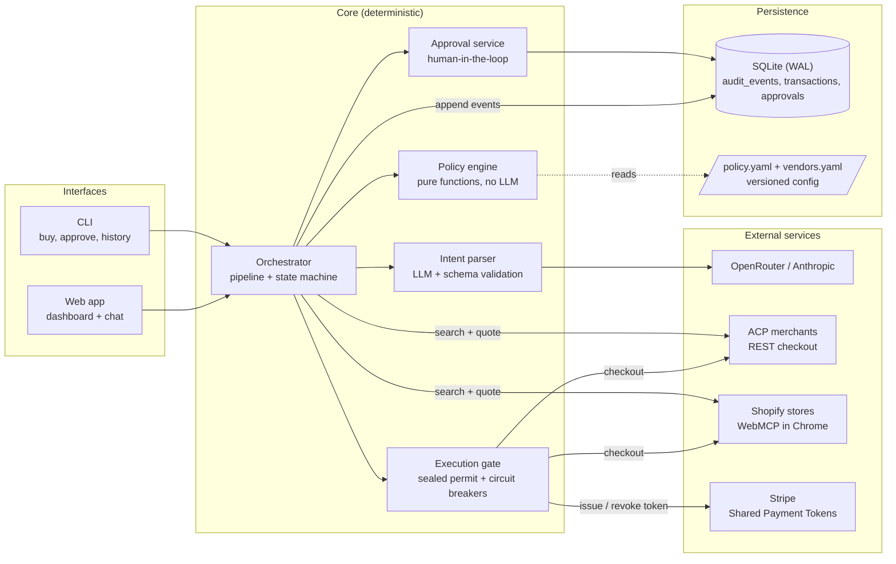
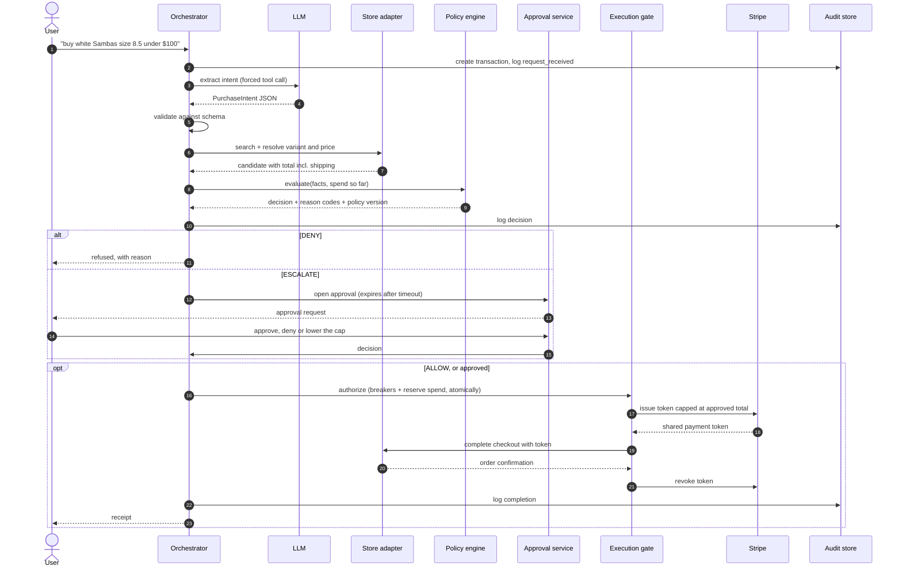
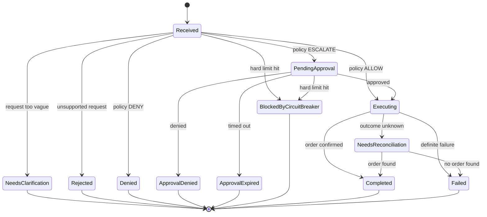
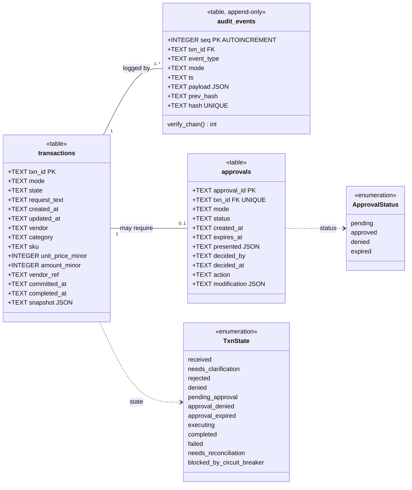
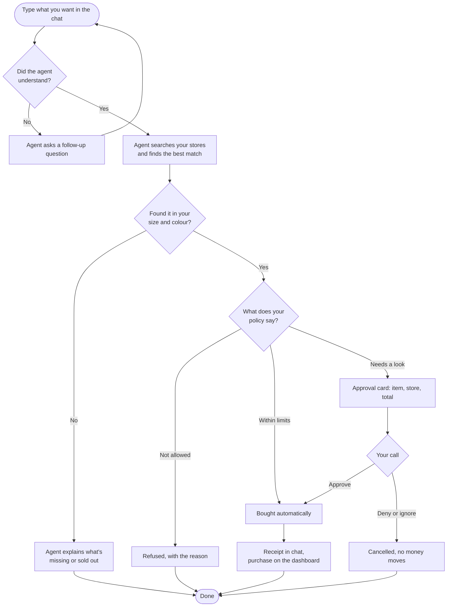

# Spenddat — Autonomous Purchasing Agent

Turns a plain-English request ("buy a phone case from acp merchant, under $25") into a real
purchase, governed by a deterministic, auditable policy engine. In-policy purchases execute
**autonomously**; only risky, ambiguous or out-of-policy ones are **escalated** to a human;
forbidden ones are **denied** outright. Every step lands in a tamper-evident audit log.

```
request ──► Intent parser (LLM, schema-validated) ──► Vendor adapter: search + resolve price
                                                          │
                              ┌── DENY ──► reject + notify user (no human, no purchase)
Policy engine (pure, no LLM) ─┼── ESCALATE ──► approval (human) ──► approve / deny / timeout
                              └── ALLOW ────────────┐                    │
                                                    ▼                    ▼
                               Execution gate ─► hard circuit breakers ─► scoped payment token
                                                 ─► vendor checkout ─► revoke token ─► audit
```

* **Vendor A:** any merchant implementing the **Agentic Commerce Protocol (ACP)** — an open
  REST checkout standard merchants publish *for* AI agents (official API, no scraping).
* **Payments:** **Stripe Shared Payment Tokens** — per-transaction, amount-capped,
  seller-scoped, time-limited, revoked after use. No card number ever touches this system.
* **Intent parsing:** Anthropic Messages API with a forced tool call, then deterministic
  validation.
* **Storage:** SQLite, hash-chained append-only audit log.

See [`docs/architecture.md`](docs/architecture.md) and the ADRs in [`docs/adr/`](docs/adr/).

## How I designed it

I wanted an agent that can actually spend money without me worrying about it. My rule
for the whole project: **the LLM never decides whether money moves.** The model only
turns my sentence into structured data. A deterministic policy engine makes the
decision, and a single execution gate is the only code path that can pay.

### User stories

I wrote these before the code and used the acceptance criteria as test cases.

| ID | As a… | I want to… | So that… | Acceptance criteria |
|---|---|---|---|---|
| US-1 | shopper | ask for a purchase in plain English ("white Sambas, size 8.5, under $100") | I don't have to browse stores myself | The request is parsed into item, size, colour, budget and store. Vague requests get a clarifying question instead of a guess. |
| US-2 | shopper | have small, in-policy purchases go through on their own | routine buying doesn't need me | An ALLOW decision executes with no human step, and the payment token is capped at the quoted total. |
| US-3 | shopper | approve risky or unusual purchases before they happen | I stay in control of anything out of the ordinary | An ESCALATE decision creates an approval showing item, store and full price. I can approve, deny or lower the cap. It expires after a timeout. |
| US-4 | shopper | have forbidden purchases refused outright | the agent can't be talked into buying something I've ruled out | Blocked stores and categories are DENIED before checkout, with a reason code. |
| US-5 | shopper | set budgets per purchase, per day, per week and per category | spending stays predictable | Policy lives in versioned YAML. Running totals are checked at the same moment the spend is reserved. |
| US-6 | shopper | shop across several stores, not just one | I get the best match and price | Every enabled store is searched; size/colour variants are matched and the cheapest valid option wins. |
| US-7 | owner | see every transaction and why it was decided that way | I can audit the agent | The dashboard shows history and spend. Each decision stores the policy version and the rules that fired. |
| US-8 | owner | know if anyone tampered with the log | the audit trail is trustworthy | Events are hash-chained and append-only. `spenddat verify-audit` detects any edited or deleted row. |
| US-9 | owner | never be charged twice, even after a crash | a timeout doesn't turn into a duplicate order | Idempotency keys on every request. Unknown outcomes go to reconciliation, never to a retry. |
| US-10 | developer | test everything without real money | I can iterate safely | Sandbox and live use separate secrets. Live needs an explicit confirmation latch. Shopify runs as a dry run in sandbox. |

### Architecture

The system has three layers. The **interfaces** take requests. The **core** decides.
The **adapters** talk to the outside world. Every adapter implements the same four-method
interface, so adding a store type never touches the policy or the orchestrator.



### Purchase sequence (technical view)

A single purchase from request to receipt. The `alt` block shows the three policy
outcomes. The payment token exists only for the few seconds of checkout and is revoked
straight after. Shopify stores skip the Stripe steps and use your saved Shop Pay card; the gate re-checks the total against the approved cap first.



### Transaction lifecycle (UML state machine)

Every transaction moves through these states and nothing else. Each transition writes
an audit event, so the state machine and the log always agree.



### Database (UML class diagram)

Three tables. `audit_events` is the source of truth. `transactions` and `approvals` are
read models I keep for fast queries. `audit_events` can't be changed after the fact:
SQLite triggers abort any `UPDATE` or `DELETE`, and each row stores the SHA-256 of the
previous row, so any edit breaks the chain. Money is always stored in integer cents,
never floats.



The indexes are `ix_events_txn(txn_id)` for per-transaction history and
`ix_txn_mode_state(mode, state)` for spend totals and the approval queue. Because every
row carries a `mode`, sandbox and live data can never be mixed up in a budget
calculation.

### How it feels to use (user view)

From the user's side it's a chat. Most purchases finish without any extra steps; the
agent only stops to ask when it should.


